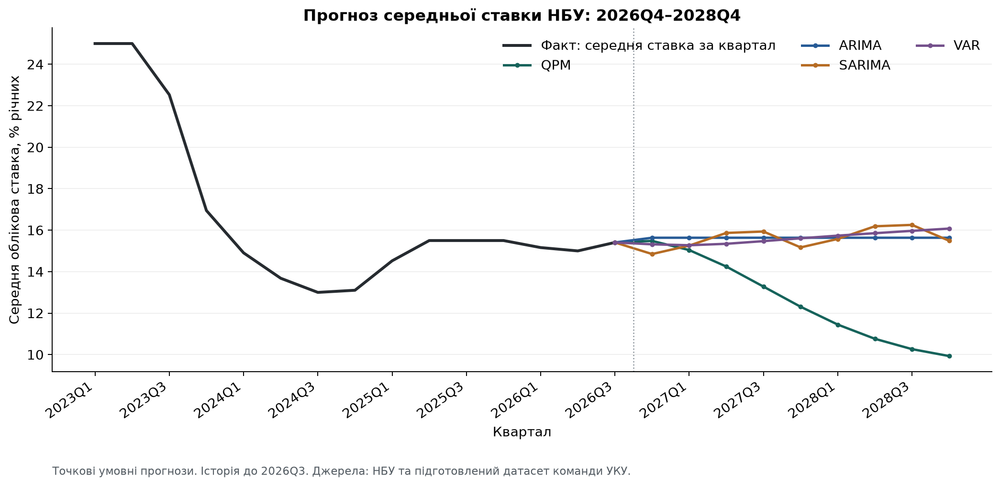
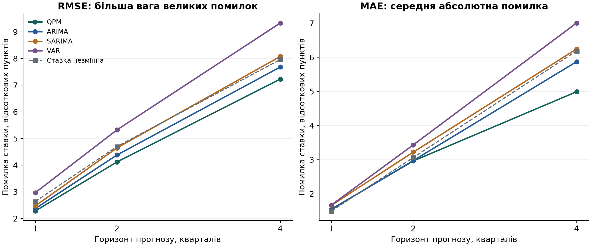

# NBU University Challenge 2026 — команда УКУ

Спільна база даних, досліджень і моделей для прогнозування облікової ставки НБУ. Поточний відтворюваний зріз — **21 жовтня 2026 року**, історія обмежена вереснем 2026.

**Ціль поточної реалізації — середня за календарні дні кварталу облікова ставка, % річних.** Прогноз рішення на конкретному засіданні та оцінка оптимальної монетарної політики — окремі наступні завдання.

## Що вже готово

- Перевірені оригінальні дані НБУ, Держстату, Eurostat, ЄЦБ, World Bank та FAO; реєстр із 23 джерельних записів.
- Основна повна вибірка: **66 кварталів, 2010Q1–2026Q2, сім показників**. Останній неповний квартал збережений окремо.
- Справжня Excel-книга з окремими числовими комірками, CSV для Python/MATLAB та окремі CSV для локальних налаштувань Excel.
- Python-версія QPM за рівняннями навчального шаблону НБУ; окремі ARIMA, SARIMA та VAR.
- Історична перевірка: **31 дата старту, 356 прогнозів**, горизонти 1, 2 і 4 квартали.
- Прогнози до 2028Q4, графіки, перевірки й пояснення обмежень.

## З чого почати

1. [Контекст, поточні завдання та межі дослідження](docs/project/CONTEXT_UA.md).
2. [Детальний звіт про джерела](docs/research/sources_ua.md).
3. [Excel для перегляду](data/QPM_ready.xlsx) або [готові основні спостереження](data/model/quarterly_training.csv).
4. [Звіт про моделі, результати й обмеження](reports/2026-10-21/REPORT_UA.md).
5. [Правила спільної роботи](CONTRIBUTING.md).

HTML-звіт із таблицями та графіками: [`reports/2026-10-21/report.html`](reports/2026-10-21/report.html). GitHub показує HTML як файл; для перегляду завантажте репозиторій і відкрийте його у браузері. Короткі графіки є нижче.

## Структура

```text
data/
  raw/                 Незмінені завантаження з офіційних джерел
  inputs/              Вилучені значення для повторної підготовки
  model/               Узгоджені ряди для моделей
  csv_for_excel/       CSV з «;» та десятковою комою
  documentation/       Джерела, словник, покриття, клітинки, перевірки
  reproduce/           Повторне вилучення й підготовка числових даних
  QPM_ready.xlsx       Готова Excel-книга
models/                qpm.py, arima.py, sarima.py, var.py та спільний запуск
tests/                 Тести моделей та цілісності джерел
results/2026-10-21/     Прогнози, історичні помилки, стани, діагностика
reports/2026-10-21/     Український звіт, HTML і графіки
docs/
  project/             Контекст, стан робіт, інвентар матеріалів
  research/            Джерела, робочі теоретичні нотатки, література
  methodology/         Методика обробки та відтворення
  findings/            Навігація висновками та відкриті питання
tools/                 Перевірка/відтворення даних, допоміжний Excel-builder
nbu_challenge_model_2026/  Початковий MATLAB/IRIS-шаблон, доданий партнером
base_data.csv/.xlsx    Початкові національні рахунки партнера
```

Початкові файли партнера збережені на тих самих місцях. `base_data.*` не зшивали автоматично з нашою SA-вибіркою ВВП: це окрема таблиця з компонентами національних рахунків, для якої ще слід погодити вибір рядів і методику.

## Запуск

Потрібен Python 3.12. З кореня репозиторію:

```sh
python3 -m venv .venv
source .venv/bin/activate
python -m pip install -r requirements.txt
python models/run_all.py
python models/make_report.py
python -m unittest discover -s tests -v
```

У Windows активуйте середовище через `.venv\Scripts\Activate.ps1`; надалі використовуйте `python`.

Кожна модель запускається окремо:

```sh
python models/qpm.py --horizon 9
python models/arima.py --horizon 9
python models/sarima.py --horizon 9
python models/var.py --horizon 9
```

Історичний прогноз без перезапису основних результатів:

```sh
python models/qpm.py --origin 2023Q4 --horizon 4 --output results/local/example_2023Q4
```

Повна перевірка відтворення даних з оригіналів, без зміни робочої бази:

```sh
python tools/rebuild_data.py --check
```

Звичайний запуск моделей використовує вже підготовлені дані й не потребує доступу до сайтів НБУ. Числове відтворення не оновлює оформлений XLSX автоматично; [подробиці](docs/methodology/REPRODUCTION_UA.md).

## Перші результати

Прогноз середньої ставки на **2026Q4**: QPM **15,48%**, ARIMA **15,64%**, SARIMA **14,85%**, VAR **15,32%**.



QPM має найменшу RMSE на загальній вибірці на горизонтах 1/2/4 квартали: **2,28 / 4,12 / 7,23 в. п.** Але на один квартал орієнтир «ставка незмінна» має кращу MAE за всі чотири моделі. На цілях починаючи з 2022 року на горизонті чотири квартали ARIMA трохи краща за QPM за RMSE.



**Параметри QPM поки задані калібровкою шаблону, а не оцінені на нашій вибірці. Її модельні інтервали істотно занижують історичну невизначеність.** Дані мають поточні історичні перегляди; календар публікацій наближено правилом затримки ВВП. Це псевдопозавибіркове порівняння, а не повний тест на архівних вінтажах.

## Джерела й навчальні матеріали

[Офіційна сторінка конкурсу](https://events.bank.gov.ua/uchallenge2026/), [реєстр статистичних джерел](data/documentation/sources.csv), [література та навчальні матеріали](docs/research/READING_LIST_UA.md).

Первинні публікації, навчальний шаблон НБУ та статистика зберігають належність своїм авторам/установам. Загальну ліцензію на сторонні матеріали від імені команди не призначено.
