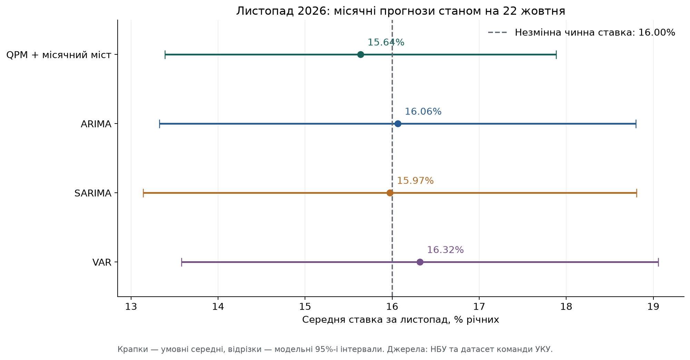
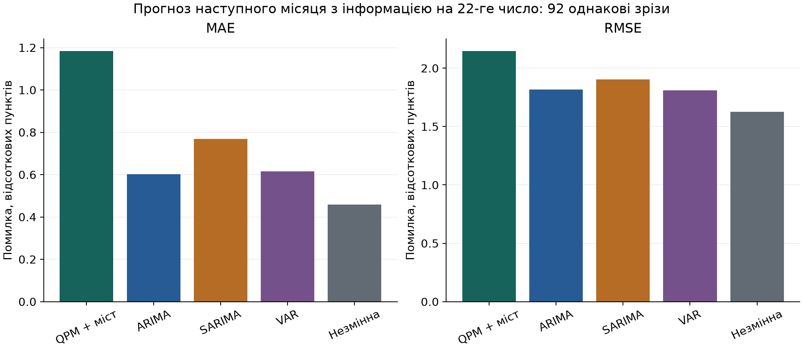

# NBU University Challenge 2026 — команда УКУ

Спільна база даних, досліджень і моделей для прогнозування облікової ставки НБУ. Поточний інформаційний зріз — **22 жовтня 2026 року**: завершені місячні макродані до вересня та відомі ставки за 1–22 жовтня.

**Поточна ціль — середня облікова ставка за всі 30 календарних днів листопада 2026 року, % річних.** Квартальні результати попередньої версії збережено як архів; їх не можна використовувати замість прогнозу листопада.

Починайте з [місячного звіту](reports/2026-10-22-monthly/REPORT_UA.md), [таблиці саме на листопад](results/2026-10-22-monthly/next_month_forecast.csv) та [методики місячного прогнозу](docs/methodology/MONTHLY_FORECAST_UA.md).

## Що вже готово

- Перевірені оригінальні дані НБУ, Держстату, Eurostat, ЄЦБ, World Bank та FAO; реєстр із 23 джерельних записів.
- Основна повна вибірка: **66 кварталів, 2010Q1–2026Q2, сім показників**. Останній неповний квартал збережений окремо.
- Справжня Excel-книга з окремими числовими комірками, CSV для Python/MATLAB та окремі CSV для локальних налаштувань Excel.
- Квартальна Python-версія QPM за шаблоном НБУ з явним місячним мостом; окремі місячні ARIMA, SARIMA та VAR.
- Поточна місячна перевірка: **92 дати старту, 368 прогнозів наступного місяця**. Архівна квартальна: 31 дата, 356 прогнозів.
- Прогноз листопада, графіки, перевірки й пояснення обмежень; старі квартальні траєкторії до 2028Q4 залишені в архіві.

## З чого почати

1. [Контекст, поточні завдання та межі дослідження](docs/project/CONTEXT_UA.md).
2. [Детальний звіт про джерела](docs/research/sources_ua.md).
3. [Excel для перегляду](data/QPM_ready.xlsx) або [готові основні спостереження](data/model/quarterly_training.csv).
4. [Актуальний прогноз листопада й обмеження](reports/2026-10-22-monthly/REPORT_UA.md).
5. [Правила спільної роботи](CONTRIBUTING.md).

HTML-звіт із таблицями та графіками: [`reports/2026-10-22-monthly/report.html`](reports/2026-10-22-monthly/report.html). GitHub показує HTML як файл; для перегляду завантажте репозиторій і відкрийте його у браузері. Короткі графіки є нижче.

## Структура

```text
data/
  raw/                 Незмінені завантаження з офіційних джерел
  inputs/              Вилучені значення для повторної підготовки
  model/               Узгоджені ряди для моделей
  csv_for_excel/       CSV з «;» та десятковою комою
  documentation/       Джерела, словник, покриття, клітинки, перевірки
  reproduce/           Повторне вилучення й підготовка числових даних
  snapshots/           Датоване підтвердження актуальних рішень НБУ
  QPM_ready.xlsx       Готова Excel-книга
models/                monthly_*.py та run_monthly.py; квартальне ядро збережене
tests/                 Тести моделей та цілісності джерел
results/2026-10-21/     Прогнози, історичні помилки, стани, діагностика
reports/2026-10-21/     Український звіт, HTML і графіки
results/2026-10-22-monthly/  Поточний прогноз листопада й місячні тести
reports/2026-10-22-monthly/  Поточний звіт і графіки
docs/
  project/             Контекст, стан робіт, інвентар матеріалів
  research/            Джерела, робочі теоретичні нотатки, література
  methodology/         Методика обробки та відтворення
  findings/            Навігація висновками та відкриті питання
tools/                 Перевірка/відтворення даних, допоміжний Excel-builder
nbu_challenge_model_2026/  Початковий MATLAB/IRIS-шаблон, доданий партнером
base_data.csv/.xlsx    Початкові національні рахунки партнера
```

Початкові файли партнера збережені на тих самих місцях. `base_data.*` не зшивали автоматично з нашою SA-вибіркою ВВП: це окрема таблиця з компонентами національних рахунків, для якої ще слід погодити вибір рядів і методику.

## Запуск

Потрібен Python 3.12. З кореня репозиторію:

```sh
python3 -m venv .venv
source .venv/bin/activate
python -m pip install -r requirements.txt
python models/run_monthly.py
python models/make_monthly_report.py
python -m unittest discover -s tests -v
```

У Windows активуйте середовище через `.venv\Scripts\Activate.ps1`; надалі використовуйте `python`.

Кожна модель запускається окремо:

```sh
python models/monthly_qpm.py
python models/monthly_arima.py
python models/monthly_sarima.py
python models/monthly_var.py
```

Історичний прогноз без перезапису основних результатів:

```sh
python models/monthly_qpm.py --as-of 2023-11-22 --output results/local/example_2023_11
```

Повна перевірка відтворення даних з оригіналів, без зміни робочої бази:

```sh
python tools/rebuild_data.py --check
```

Звичайний запуск моделей використовує вже підготовлені дані й не потребує доступу до сайтів НБУ. Числове відтворення не оновлює оформлений XLSX автоматично; [подробиці](docs/methodology/REPRODUCTION_UA.md).

## Поточний результат: листопад 2026

Прогноз **середньої ставки за листопад**: QPM + місячний міст **15,64%**, ARIMA **16,06%**, SARIMA **15,97%**, VAR **16,32%**. Орієнтир незмінної чинної ставки — **16,00%**.



На 92 однакових місячних зрізах орієнтир незмінної ставки має **MAE 0,459 в. п. та RMSE 1,626 в. п.** і перевершує всі чотири моделі за обома метриками. Тому цей запуск не дає сильного кількісного обґрунтування відхилення листопадового прогнозу від рівня близько 16%.



**QPM + місячний міст не є новою оціненою місячною структурною QPM.** Її квартальні коефіцієнти походять із шаблону; відомі місячні ставки застосовані через явний стохастичний міст. Жовтень має статус nowcast, листопад — forecast. Майбутні дні не оголошені фактами.

Зберігаються поточні історичні перегляди, наближений календар макропублікацій та умовні Gaussian-інтервали. Це псевдопозавибіркова перевірка, не повний тест на архівних вінтажах. [Архівний квартальний звіт](reports/2026-10-21/REPORT_UA.md) збережено; `models/run_all.py` запускає саме архівну квартальну задачу.

## Джерела й навчальні матеріали

[Офіційна сторінка конкурсу](https://events.bank.gov.ua/uchallenge2026/), [реєстр статистичних джерел](data/documentation/sources.csv), [література та навчальні матеріали](docs/research/READING_LIST_UA.md).

Первинні публікації, навчальний шаблон НБУ та статистика зберігають належність своїм авторам/установам. Загальну ліцензію на сторонні матеріали від імені команди не призначено.
