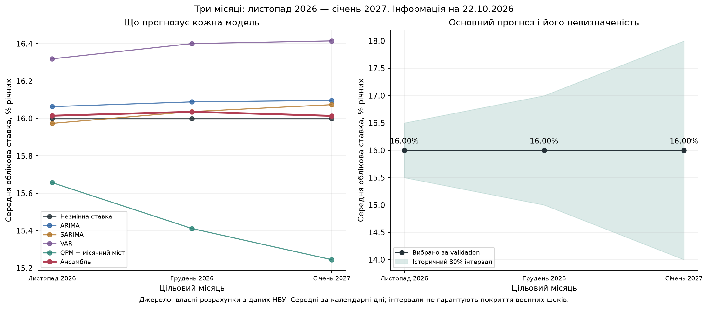

# NBU University Challenge 2026 — команда УКУ

Дослідження середньої облікової ставки на **листопад 2026, грудень 2026 і січень 2027**. Інформаційна дата — **22.10.2026**; завершені місячні макродані до вересня, відомі ставки жовтня — до 22-го включно.

## Що відкрити

1. **[Основний звіт і чотири графіки](reports/final/RESEARCH_UA.md)** — поточні результати та їхні обмеження.
2. **[Матеріали для презентації](presentation/README.md)** — порядок показу, пояснення й запитання для обговорення.
3. **[Зустріч із керівником](docs/project/MEETING_BRIEF_UA.md)** — короткий план на 5–7 хвилин.
4. **[Дані для перегляду](data/QPM_ready.xlsx)** та **[поточна доказова база](data/research/2026-10-22/README.md)**.
5. **[Джерела](docs/research/sources_ua.md)** і **[методика](docs/methodology/SHORT_TERM_UA.md)**.

## Поточний висновок

Відібраний за validation MAE основний прогноз — **16% / 16% / 16%**. Ансамбль ARIMA, SARIMA, VAR, QPM із місячним мостом та незмінної ставки дає **16,015% / 16,036% / 16,014%**. Ансамбль поки не довів стійкої переваги за MAE над незмінною ставкою. Це прогноз фактичної ставки; рекомендація монетарного рішення потребує окремого обґрунтування й погодження командою.

Перевірка охоплює 1 638 історичних прогнозів. Використано переглянуті макродані й наближені лаги публікації; пізніший аудит не є незайманим зовнішнім тестом. Папка `final` означає поточний комплект для обговорення, а не затверджене подання на конкурс.



## Структура

- `reports/final/` — єдиний актуальний звіт, HTML і чотири графіки.
- `presentation/` — сценарій показу та підписи до графіків; готового PPTX тут немає.
- `results/2026-10-22-short-term/` — точні прогнози, ваги, помилки, кеш і контрольні суми одного актуального запуску.
- `data/` — первинні файли, модельні ряди, Excel, джерела й підготовка даних.
- `models/` — моделі та розрахункові функції; [навігація](models/README.md).
- `tools/`, `tests/`, `.github/` — відтворення та перевірки.
- `docs/` — методика, джерела, правила конкурсу й контекст роботи.
- `nbu_challenge_model_2026/` — незмінений початковий шаблон НБУ.
- `base_data.csv`, `base_data.xlsx` — початкові національні рахунки партнера, збережені без змін; автоматично до моделей не підмішуються.

Попередні квартальні, одномісячні й довгі звіти прибрано з поточної версії. [Відновлення попередніх матеріалів](docs/project/HISTORY_UA.md).

## Відтворення

Python 3.12, із кореня репозиторію:

```sh
python3 -m venv .venv
source .venv/bin/activate
python -m pip install -r requirements.txt
python tools/run_research.py
python tools/verify_short_term.py
python -m unittest discover -s tests -v
```

Для повного повторного оцінювання моделей: `python tools/run_research.py --refresh`. Звичайний запуск використовує кеш, лише якщо його вхідні SHA256 збігаються. Працює офлайн; автоматично нові дані не завантажує.

Перевірка підготовки даних: `python tools/rebuild_data.py --check`. [Повна методика відтворення](docs/methodology/REPRODUCTION_UA.md), [правила спільної роботи](CONTRIBUTING.md), [умови конкурсу](docs/project/COMPETITION_BRIEF_UA.md).

Первинні публікації та шаблон НБУ належать своїм авторам/установам; загальну ліцензію на сторонні матеріали від імені команди не призначено.
