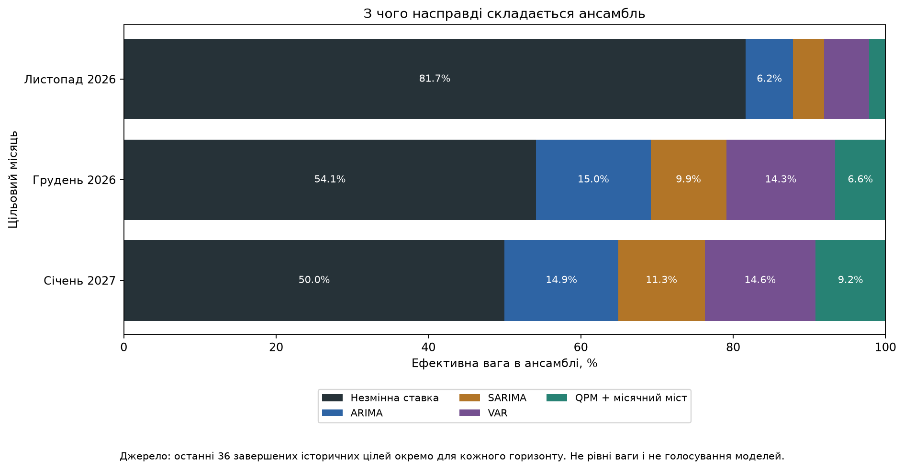
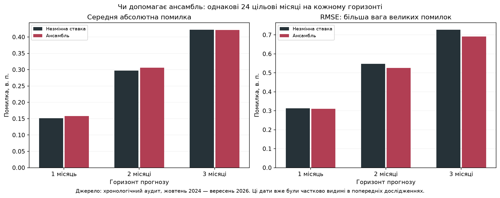
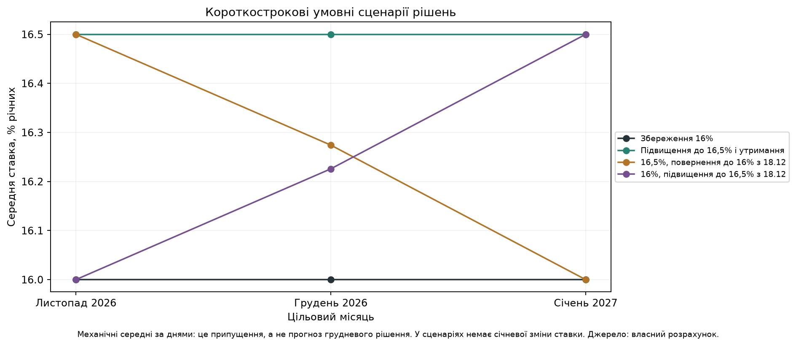

# Короткострокове дослідження: три місяці

Інформаційна дата — **22 жовтня 2026**. Єдина поточна прогнозна область: **листопад 2026, грудень 2026, січень 2027**. Показник — середня облікова ставка за всі календарні дні кожного місяця, % річних. Далекі траєкторії не входять до висновків цього звіту.

## Прогноз і наглядні графіки

| Модель | Листопад 2026 | Грудень 2026 | Січень 2027 |
| --- | --- | --- | --- |
| Незмінна ставка | 16.0 | 16.0 | 16.0 |
| ARIMA | 16.063 | 16.089 | 16.097 |
| SARIMA | 15.974 | 16.037 | 16.074 |
| VAR | 16.319 | 16.401 | 16.415 |
| QPM + місячний міст | 15.657 | 15.411 | 15.244 |
| Ансамбль | 16.015 | 16.036 | 16.014 |

Основний прогноз обирається окремо для кожного горизонту за помилкою на validation, а не за назвою моделі. Ось відібрані прогнози та історично калібровані інтервали:

| period | model | prediction | lower80 | upper80 |
| --- | --- | --- | --- | --- |
| 2026-11 | NO_CHANGE | 16.0 | 15.5 | 16.5 |
| 2026-12 | NO_CHANGE | 16.0 | 15.0 | 17.0 |
| 2027-01 | NO_CHANGE | 16.0 | 14.0 | 18.0 |

Інтервали побудовані з уже завершених минулих помилок відповідного горизонту. Це не гарантія ймовірності за воєнного структурного зламу.

## Які моделі є в ансамблі та як вони працюють

**ARIMA** дивиться на історію самої ставки: її попередні рівні/зміни й те, як модель помилялася. Вона продовжує оцінену часову закономірність. Не знає сама по собі про новий обстріл чи рішення Правління. Специфікація обирається за AICc тільки на навчальному минулому.

**SARIMA** додає до ARIMA можливість річного повторення через 12 місячних спостережень. Для облікової ставки сезонність не очевидна: це перевірювана гіпотеза, а не причина автоматично довіряти моделі більше.

**VAR** розглядає взаємозв'язки чотирьох рядів: змін ставки НБУ, місячної інфляції, змін UAH/EUR та змін ставки ЄЦБ. Прогнозує їх разом із лагами. Кількість лагів обирається за BIC, з перевагою стабільних і достатньо компактних моделей. Наявність зв'язку не доводить причинність.

**QPM + місячний міст** використовує квартальні економічні рівняння: попит, інфляцію, курс і правило ставки. Міст переводить розподіл квартального середнього в місячні значення, зберігаючи квартальне обмеження й враховуючи відомі ставки. Квартальну модель не перетворено на місячну простим перейменуванням дат; місячний ВВП не вигадується. Публікуємо тільки результати трьох цільових місяців.

**Незмінна ставка** — додатковий стабілізатор: чинні 16% зберігаються в прогнозному місяці. За рішеннями, які часто не змінюються, цей простий орієнтир може бути точним.

Саме **чотири моделі плюс стабілізатор** утворюють цей ансамбль. Ridge й локальні тренди з попереднього пошуку були конкурентами, але **не входили до чотиримодельного ансамблю**. Не змішуємо кількість перевірених кандидатів зі складом суміші.

## Як визначаються ваги

1. Для кожного горизонту окремо беремо останні 36 історичних цілей, які вже завершилися на дату прогнозу. Потрібно щонайменше 12.
2. Чотирьом моделям надаємо ваги, обернені до їхньої минулої MAE. Нижня межа помилки 0,05 в. п. запобігає надмірній вазі майже нульової оцінки.
3. Історичні помилки визначають, яку частину залишити цій суміші, а яку — незмінній ставці. Частка моделей обмежена 50%, щоб не переносити слабкий сигнал у надмірну зміну прогнозу. Це явний параметр методики.
4. Остаточний прогноз = вага незмінної ставки × 16% + зважені прогнози чотирьох моделей. Усі ваги невід'ємні й разом дорівнюють 100%. Вони не є ймовірностями майбутніх рішень.

Фактичні ефективні ваги поточного запуску, %:

| Місяць | Незмінна ставка | ARIMA | SARIMA | VAR | QPM + місячний міст |
| --- | --- | --- | --- | --- | --- |
| 2026-11 | 81.66 | 6.2 | 4.05 | 5.96 | 2.14 |
| 2026-12 | 54.14 | 15.03 | 9.93 | 14.32 | 6.59 |
| 2027-01 | 50.0 | 14.92 | 11.34 | 14.56 | 9.18 |

Нульова або мала вага означає, що минулі дані не дають достатнього сигналу довіряти цій складовій сильніше. Вона не означає, що модель пояснює нуль відсотків економіки.

## Чи ансамбль кращий

Перевірені шість кандидатів: чотири моделі, незмінна ставка й ансамбль. Для кожної історичної дати моделі заново навчалися лише на доступному минулому; поточний місяць враховано як неповний, не як відому місячну ціль. Ваги та інтервали також використовують лише завершені цілі.

Validation закінчується вереснем 2024. На пізнішому аудиті — однакові 24 цільові місяці від жовтня 2024 до вересня 2026 для кожного горизонту. Кількість усіх історичних цілей різниться за горизонтом: найдальші ще не завершилися. Усередині одного горизонту всі шість моделей порівнюються на однакових датах.

| horizon | model | n | MAE_pp | RMSE_pp |
| --- | --- | --- | --- | --- |
| 1 | NO_CHANGE | 24 | 0.1515 | 0.3135 |
| 1 | ENSEMBLE | 24 | 0.1582 | 0.3109 |
| 1 | ARIMA | 24 | 0.1652 | 0.2972 |
| 1 | VAR | 24 | 0.1779 | 0.2523 |
| 1 | SARIMA | 24 | 0.3364 | 0.4016 |
| 1 | QPM_BRIDGE | 24 | 0.4399 | 0.6992 |
| 2 | NO_CHANGE | 24 | 0.2973 | 0.5476 |
| 2 | ENSEMBLE | 24 | 0.306 | 0.5256 |
| 2 | ARIMA | 24 | 0.3173 | 0.5375 |
| 2 | VAR | 24 | 0.3694 | 0.4876 |
| 2 | SARIMA | 24 | 0.6115 | 0.6909 |
| 2 | QPM_BRIDGE | 24 | 0.6768 | 1.0346 |
| 3 | ENSEMBLE | 24 | 0.4216 | 0.6915 |
| 3 | NO_CHANGE | 24 | 0.4223 | 0.7273 |
| 3 | ARIMA | 24 | 0.4448 | 0.7246 |
| 3 | VAR | 24 | 0.5208 | 0.6515 |
| 3 | SARIMA | 24 | 0.741 | 0.876 |
| 3 | QPM_BRIDGE | 24 | 0.8106 | 1.1813 |

Правило вибору — validation MAE, потім RMSE. Не переобираємо модель за зручнішим audit-показником. Ці історичні дати вже були частково видимі в попередній роботі, а дані містять перегляди й приблизні лаги публікації: це хронологічний аудит, не незайманий real-time тест. Краща складність не гарантує кращої точності.

## Ставка, рекомендація і календар рішень

Прогноз фактичної ставки та бажане рішення — різні питання. Попередня робоча рекомендація 16,5% не стає автоматично прогнозом усіх трьох місяців і ще не є затвердженим командою рішенням. Наступні кроки потрібно переглядати за інфляцією, очікуваннями, валютним ринком і активністю.

Статистичні прогнози є неперервними очікуваннями; вони не означають, що НБУ встановить ставку з точністю до сотих. Грудневе та січневе рішення можуть змінити місячне середнє залежно від дати набрання чинності. Наприклад, зміна з 18 грудня впливає на 14 із 31 дня цього місяця.

Цей останній графік — механічні календарні сценарії, не оцінка впливу на інфляцію або ВВП. Монетарна передача має лаги; з тримісячного прогнозу ставки не випливає гарантоване зниження інфляції до січня. Окремих місячних прогнозів ВВП із квартальної QPM тут немає.

## Відтворення й джерела

`python tools/run_research.py` — поточний тримісячний запуск; `python tools/verify_short_term.py` — незалежна перевірка. Дані й точні ваги: `results/2026-10-22-short-term/`. Вихідні дані НБУ, Eurostat/ЄЦБ та первинні файли описані в [аудиті джерел](../../docs/research/DATA_GAPS_2026_10_22_UA.md). [Офіційний календар НБУ](https://bank.gov.ua/ua/monetary/schedule). Первинна макроісторія завершена вереснем 2026; відомі ставки за 1–22 жовтня використано окремо. Припущення про незмінність майбутньої ставки не видаються за факти.
