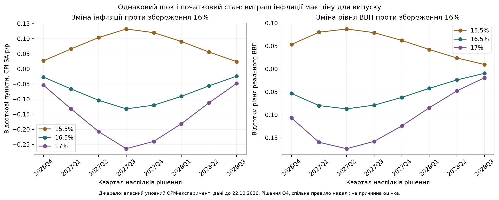
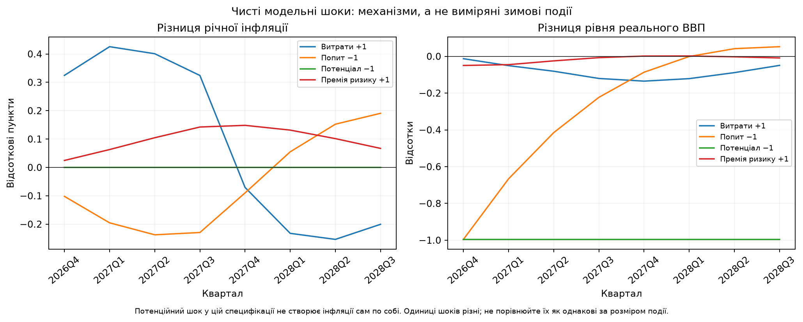
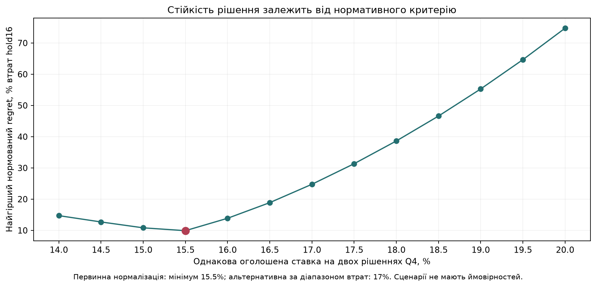

# Умовне монетарне рішення: витрати, зимові ризики та слабкий попит

**Дата підготовки — 23.10.2026. Факти — доступні до кінця 22.10.2026; місячна макроісторія — до вересня.** Повідомлення Нафтогазу 22.10 о 13:38 не було доступне для раннього внутрішньоденного запуску цього дня; тут використовується явно ширший зріз кінця дня. Нових фактів майбутньої зими або рішень НБУ не додано.

## Рекомендація для обговорення командою

**Зберегти облікову ставку 16% на найближчому рішенні, не оголошувати цикл зниження й залишити можливість кроку до 16,5% за підтвердження стійкого вторинного інфляційного та валютно-очікувального тиску.** У грудні й січні переоцінювати дані; це не зобов'язання тримати ставку всі три місяці.

Це **експертний умовний висновок** за суперечливих модельних сигналів. Модель не довела 16% оптимальними: первинний сценарний minimax обрав 15,5%, інша нормалізація — 17%, центральний сценарій окремо тяжіє до значно вищої ставки. Числа не приховуємо й не міняємо критерій після результату. Обережність щодо одночасного зниження за інфляційного сюрпризу і різкого підвищення за невизначеного gap є явним судженням, а не новою оціненою функцією добробуту.

Супровідний пакет: зберігати дієвість процентного сигналу для гривневих заощаджень; не фіксувати новий курсовий рівень і не пропонувати разову девальвацію як засіб ремонту виробничих потужностей; валютну гнучкість та інтервенції оцінювати разом з фінансуванням і ринковим тиском. Не вводити широкі нові валютні заборони без конкретної оцінки проблемного потоку. Комунікувати відсутність потреби емісійного фінансування як бажану складову узгодженого пакета, а не нібито змодельований прогноз бюджетних рішень. Поточна модель не оцінює чисельно оптимальний обсяг інтервенцій чи резервів.

## 1. Що приймаємо за факти

- Вересневий CPI: **10% р/р, 2,1% м/м**; базова інфляція **8,8% р/р**, послуги **13,7% р/р**, пальне **+46,2% р/р**. НБУ пов'язує відхилення від липневого прогнозу з атаками на виробництво/логістику та дорожчим пальним. Типографічне тире перед 46,2 в тексті не означає падіння цін. [НБУ, 12.10](https://bank.gov.ua/ua/news/all/komentar-natsionalnogo-banku-schodo-rivnya-inflyatsiyi-u-veresni-2026-roku).
- BOS Q3: серед обмежень виробництва війна **82,8%**, кадри **51,1%**, енергоціни **41,7%**, недостатній попит **30,9%**. Серед чинників власних цін: енергія **64,3%**, сировина **61,4%**, праця **55,6%**, попит **19,1%**, логістика **37%**. Це частки відповідей із множинним вибором, не ваги CPI або еластичності. Джерело: [BOS, PDF с.56 і 59](https://bank.gov.ua/admin_uploads/article/BOS_2026-Q3.pdf).
- Очікування інфляції бізнесу на 12 місяців **11,5% проти 11,6%** у попередньому кварталі. Рівень високий, але саме цей ряд **не доводить нового погіршення**. Польова хвиля Q3 — 30.07–28.08; реліз 15.10 не робить відповіді жовтневими. Не змішуємо очікування підприємств, населення й аналітиків в одне число.
- Нафтогаз 22.10 повідомив про **24 сценарії зимового проходження**, з урахуванням атак і погоди. Це доказ необхідності сценарного аналізу, а не прогноз дефіциту газу чи ймовірність блекауту. [Первинне повідомлення](https://www.naftogaz.com/news/naftogaz-prepares-24-winter-scenarios-factoring-in-russian-attacks-and-weather-conditions).
- Закон №3878-IX передбачає новий крок паливних акцизів із **01.01.2027**: бензин 300,8→329,9, дизель 253,8→291,9, LPG 198→223 EUR/1000 л. Це ставки податку, не відсоткове зростання роздрібної ціни й не ефект CPI. [Закон](https://zakon.rada.gov.ua/laws/show/3878-20#Text). У Q4 його вдруге не додаємо до вже наявної дорожнечі пального.

[Збережені першоджерела й походження](../../data/policy/2026-10-23-scenarios/sources_manifest.json), [перевірка фактів і меж](../../docs/research/2026-10-23-conditional-decision/SHOCK_EVIDENCE_UA.md).

Противага зимовому стресу: у вересневому опитуванні НБУ стабільніше енергопостачання підтримувало активність. Отже, зимові перебої не можна видавати за вже реалізований загальнонаціональний дефіцит; див. реєстр доказів.

## 2. Діагноз і припущення про gap

**Основний робочий діагноз:** широкий тиск витрат, посилений дорогим пальним і виробничо-логістичними обмеженнями, за одночасно неоднорідного/слабкого попиту. Небезпека зими — триваліші витрати й вторинні ефекти, а не вже встановлений факт нового розбалансування очікувань.

Падіння фактичного ВВП від довоєнного рівня не є розривом попиту. Потенціал також міг зменшитися. Центральний відфільтрований gap 2026Q3 **+0,462 лог-пункту** — модельна оцінка, а не офіційне спостереження. Для стрес-перевірки взято три раніше отримані повні вектори стану: gap **−0,610 / +0,462 / +1,711**. Вони відрізняються й іншими прихованими станами; це не чисте втручання лише в gap і не довірчий інтервал. Факт ВВП доступний до 2026Q2.

Нові публікації IEA 2025 / початку 2026 пояснюють механізми енергетичної вразливості, але їхні цифри минулої зими не є виміром потужностей зими 2026/27. Кількість атак також не конвертуємо у втрачений відсоток GDP без розрахунку.

## 3. Сценарії: що саме припущено

Спочатку — чисті проби моделі: витрати +1, попит −1, потенціал −1 та премія ризику +1 у власних одиницях рівнянь. Вони потрібні для перевірки механізмів і **не входять у ранжування рішення**.

Для рішення — вісім умовних гіпотез:

1. Нижчий ціновий міст.
2. Центральний міст до раніше відібраного статистичного прогнозу CPI.
3. Вищий міст.
4. Центральний міст плюс зимовий хвіст витрат.
5. Центральний міст плюс слабкий попит.
6. Центральний міст плюс валютна премія.
7. Центральний міст плюс поєднання втрати потенціалу, витрат і слабшого попиту.
8. Центральний міст плюс стійкіший ціновий тиск.

Міст — залишок для узгодження QPM зі статистичним прогнозом, не виміряний чистий шок енергії. Його центральна величина **9,70 аннуалізованого квартального лог-пункту** залишається суттєвою проблемою інтерпретації. Нижня/верхня версії успадковують exploratory audit-RMSE попереднього запуску; це не нова незалежна оцінка інтервалу.

Зимовий хвіст +2 і +1 у наступних двох кварталах, попит −1, премія +1 із хвостом +0,5 та комбінована втрата потенціалу −1 — **прозорі сценарні одиниці, не економетричні оцінки**. Не заявляємо, що подорожчання пального на 46,2% спричиняє саме такий шок. Для кількісного зв'язку потрібні ваги CPI, витратні частки, передача й податкове навантаження. Стійкий ціновий залишок не є ендогенним блоком довіри; вигода «збереження довіри» тут чисельно не оцінена.

[Точні інновації](../../results/2026-10-23-conditional-decision/scenario_assumptions.csv), [протокол](../../results/2026-10-23-conditional-decision/protocol.json).

## 4. Що реально перераховано

13 ставок **14–20% із кроком 0,5** на двох рішеннях Q4; після Q4 — однакове ендогенне правило. Це не обіцянка фіксувати ставку на вісім кварталів. Квартальна модель бачить середнє за календарними днями, а не повну денну передачу.

Повні початкові вектори стану перехрещено з beta **0,5 / 0,7 / 0,9**. У межах одного стану при зміні beta сам стан і немонетарні інновації зберігаються. Beta — вага керованої курсової цілі проти UIP, а не обсяг інтервенцій. Діапазон є припущенням, не оціненим довірчим інтервалом.

Разом: **864 контексти**, **11 232 оцінки втрат**, **6 160 рядків траєкторій**, окремі прямі перевірки розв'язку. Контексти включають сценарій, стан, beta, нормативні ваги та горизонт 8/12 кварталів; це не незалежні історичні спостереження. Рівняння первинної моделі не переписувалися під бажану ставку.



За центрального стану й beta=0,7 підвищення **16→16,5%** у двох рішеннях Q4 дає приблизно **−0,132 в.п. інфляції** на піку та **−0,087% рівня GDP**. Це різниця між умовними траєкторіями, не гарантований ефект. Графік наслідків на 8 кварталів показує лаги; він не є основним прогнозом далеких ставок.



Чистий шок потенціалу в навчальній специфікації знижує рівень GDP, але сам по собі не створює інфляції. Тому кейс руйнування потужностей не можна кількісно довести лише таким шоком. Усі чисті проби мають різні одиниці; їхні амплітуди не порівнюються як однакові фізичні події.

## 5. Незручний, але необхідний результат стійкості

Первинний критерій — найменший найгірший regret: різниця з найкращою ставкою в тому самому контексті, поділена на втрати hold16 цього контексту. Це нормативне правило без імовірностей сценаріїв; не історична частота успіху. Перевіряємо також іншу нормалізацію на діапазон втрат альтернатив.

- Первинний критерій обирає **15,5%**: найгірший нормований regret **9,90%**.
- Для **16%** — **13,88%**, для **16,5%** — **18,89%**.
- Нормалізація на діапазон втрат обирає **17%**.
- Центральний сценарій за окремими вагами продовжує тяжіти до **19,5%**.



Отже, первинний математичний результат **не підтвердив нашу експертну пропозицію hold16**. Не переобираємо критерій, щоб він її підтвердив. Розбіжності показують залежність від структури, початкового стану, великого мосту CPI, нормативних ваг і невстановленої правдоподібності сценаріїв. Рекомендація 16% тут є обережною позицією для обговорення, а не остаточно доведеним модельним оптимумом. Якщо команда вимагає винятково результат первинного критерію, потрібно чесно представляти 15,5% **за цим конкретним протоколом** або відкласти вибір до усунення невизначеності, а не називати 16% переможцем.

## 6. Три докази на користь умовного утримання

1. **Діагноз не зводиться до перегріву попиту.** Дані витрат і виробничих обмежень співіснують із недостатнім попитом. Ставка не відновлює втрачені потужності; зайве охолодження має ціну. Це не твердження, що попитовий тиск відсутній усюди.
2. **Високі очікування поки не дорівнюють новому розбалансуванню.** Q3 бізнес-очікування 11,5 проти 11,6 не доводять погіршення. Але стара хвиля не гарантує жовтневої стабільності, тож відсутність свіжого доказу не є доказом відсутності ризику. Потрібен новий сигнал до наступного перегляду.
3. **Кількісна перевага додаткового кроку не стійка.** За центрального калібрування ефект +50 б.п. невеликий, а знак бажаного рішення змінюється за інших допустимих припущень. Утримання дозволяє отримати додаткову інформацію, зберігаючи готовність до реакції. Цінність очікування інформації є якісним аргументом, не оціненим числом у loss.

Ці аргументи достатні для прозорої умовної позиції, але не усувають головного заперечення нижче. Висока headline-інфляція також не є автоматичною підставою для пом'якшення.

## 7. Найсильніший контраргумент

**Пальне, базова інфляція й послуги можуть свідчити, що первинний шок уже стає широким та стійким. Очікування у воєнній економіці можуть реагувати швидше, ніж їх встигають виміряти опитування. Очікування нових даних може коштувати довіри й резервів; крок +50 б.п. зараз може бути страховкою.**

Цей аргумент підтримує можливість 16,5%. Проте наша модель не має належно оціненого ендогенного блоку довіри та резервів. Ми не можемо написати, що графік довів, скільки доларів заощадить підвищення. Праці про довіру пояснюють механізм, але не визначають потрібні +50 б.п. за нас.

## 8. Умови перегляду: що спостерігати й яке рішення розглядати

**До посилення, робочий наступний крок 16,5%:** підтвердження широкого й стійкого прискорення базової інфляції/послуг у наступних доступних релізах разом із погіршенням очікувань тієї самої групи на тому самому горизонті; або помітне стійке посилення валютного попиту, яке не пояснюється календарем розрахунків/відомими потоками допомоги, за слабкої передачі ставки в гривневі заощадження. Окремий стрибок одного товару не є достатнім автоматичним тригером.

**До пом'якшення:** підтверджене ослаблення попиту й негативний gap у кількох обґрунтованих специфікаціях, зниження базового тиску/очікувань та відсутність посилення валютного ризику. Тоді 15,5% стає предметом рішення; первинний сценарний мінімум уже показує, чому цю альтернативу не можна викреслити.

**За сильнішого спільного зимового й валютного шоку:** переглянути весь пакет, масштаб і тривалість рішення, а не автоматично повторювати +0,5. Наша рекомендація не обмежує допустиму реакцію 16,5%, якщо факти істотно зміняться.

Числових порогів «більше 12% очікувань» або «інтервенції понад 5 млрд» не встановлено: немає перевіреної статистики, яка робить саме ці межі оптимальними. Умови є планом перегляду експертного рішення, не бек-тестованим автоматичним правилом. Для грудневого рішення потрібні нові доступні дані; цифри з майбутнього до поточного висновку не підставляємо.

## 9. Як використали статтю Козюка

Прочитано шість наданих фото. Основні корисні гіпотези: стійкість витрат, травматичний досвід інфляції, очікування, значення резервів і обмеження девальваційного розв'язку. Це авторська колонка, не емпірична ідентифікація. Користувач підтвердив 23.10, що платна стаття датована 22.10.2026; на фото видно 14:39. Ця дата має статус підтвердження користувачем, а не незалежної вебперевірки; оригінальний URL залишається невідомим. Статтю враховано в зрізі кінця дня 22.10 як авторську аргументацію, її числові твердження перевіряються окремо.

Правило «негативний шок пропозиції завжди потребує зниження ставки» не універсальне. Пропускати тимчасовий ціновий ефект можна лише з урахуванням очікувань, тривалості та початкових умов. Наведені в колонці покриття депозитів резервами не є IMF ARA; критерій їхньої адекватності окремо не встановлений. Загальні твердження про те, що світ ніколи не повернеться до низьких ставок, не є вхідним прогнозним фактом.

[Повний аудит тез і першоджерела теорії](../../docs/research/2026-10-23-conditional-decision/KOZIUK_AND_THEORY_UA.md), [незалежна перевірка рішення](../../docs/research/2026-10-23-conditional-decision/DECISION_ROBUSTNESS_UA.md).

## Відтворення

```sh
python models/conditional_policy.py
python models/make_conditional_report.py
python tools/verify_conditional_policy.py
python -m unittest discover -s tests -v
```

Запуск використовує незмінене структурне ядро, попередні збережені початкові стани та явні нові сценарії. Не переоцінює причинні еластичності й не оновлює інформаційний зріз автоматично. Збережено протокол, інновації, траєкторії, втрати, перевірки та SHA256.
