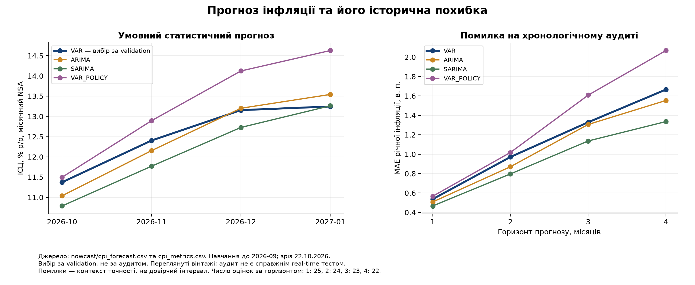
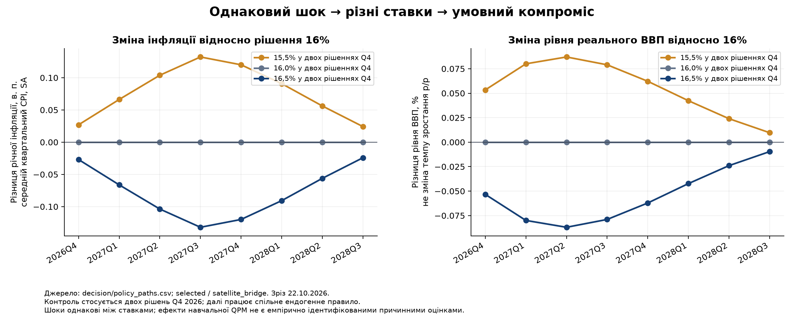

# Фактичний запуск: дані, прогнози та умовний вибір політики

Зріз: **22.10.2026**. Цю записку створено зі збережених результатів запуску, без повторного підбору моделі за зручним висновком. Це дослідницький результат; остаточне рішення команди щодо ставки ще не затверджено.

## Що реально виконано

Розширення містить 8506 значень 33 рядів: 994 значення нових офіційних історій резервів/інтервенцій, 6552 нові витяги компонентів CPI зі старої книги та 960 явно повторно використаних якорів. Нові первинні ряди звірено з [графіком резервів НБУ](https://bank.gov.ua/ua/markets/international-reserves-allinfo/dynamics) та [сторінкою інтервенцій НБУ](https://bank.gov.ua/ua/markets/currency-interventions). Походження кожного значення, одиниці, клітинки/API й SHA-256 записано в data/policy/2026-10-22/long.csv та маніфесті. Невідомі історичні дати публікації не вигадано.

Виконано статистичні сателіти SEASONAL_NAIVE, ARIMA, SARIMA, VAR, VAR_POLICY; прогноз CPI відокремлено від рекомендації ставки. Перевірено 9 обмежених калібрувань QPM. Найкраще поліпшення validation становило 1,26%, за необхідних 5%; збережено виправлений початковий шаблон. Ставка не входила в ціль вибору калібрування.

Політичний запуск містить **8,064 рядків траєкторій**, **191,646 оцінок втрат**, **1,134 умовних переможців**, 9 варіантів моделі та 7 сценаріїв. Варіанти: beta_0.5, beta_0.9, corrected_template, no_gap_judgment, potential_growth_4, selected, strong_gap_judgment, war_potential_std_0, war_potential_std_30. Сценарії: bridge_high, bridge_low, inherited_only, negative_demand, persistent_cost, risk_premium_stress, satellite_bridge. Кількості сценаріїв і переможців не є ймовірностями. Максимальний перевірений числовий залишок: 5.46e-12; це перевірка розв'язання рівнянь, не економічної правдивості.

## Власний прогноз загальної інфляції

Модель обрана за validation, окремо за горизонтом. Поточне навчання закінчується вереснем 2026. Усі числа нижче — прогнози місячного CPI NSA, а не майбутні факти:

- 2026-10: 2,15% м/м; 11,37% р/р; VAR.
- 2026-11: 1,33% м/м; 12,40% р/р; VAR.
- 2026-12: 0,87% м/м; 13,15% р/р; VAR.
- 2027-01: 0,78% м/м; 13,24% р/р; VAR.

Аудит не використано для зміни переможця validation. На горизонті 3 місяці фактичний MAE річної інфляції становить:

- модель: SARIMA, MAE, в. п.: 1,14, RMSE, в. п.: 1,41, оцінок: 23
- модель: VAR, MAE, в. п.: 1,33, RMSE, в. п.: 1,57, оцінок: 23
- модель: VAR_POLICY, MAE, в. п.: 1,61, RMSE, в. п.: 1,88, оцінок: 23

SARIMA на цьому аудиті може бути точнішою за вибраний VAR. Додавання валютного сигналу у VAR_POLICY не довело прогнозної переваги. Наявність нового показника не є підставою автоматично збільшити його вагу або оголосити його причинним ефектом ставки. Дані переглянуті; лаги доступності приблизні, дати аудиту раніше частково переглядалися. Це хронологічна діагностика, не незайманий real-time тест. RMSE не перетворюється автоматично на довірчий інтервал.

## Що показав контрольований експеримент

Рішення моделюються на 2026-10-29, 2026-12-17; набрання чинності наступного дня — сценарна конвенція. Квартальна формула: `(29*16 + 49*october_rate + 14*december_rate)/92`. Через квартальну частоту два різні внутрішньоквартальні шляхи з однаковим середнім дають однаковий макроефект. Повний календар не верифіковано наживо через HTTP 403 — це обмеження протоколу.

У selected / satellite_bridge майбутні ціни прив'язано до validation-вибраного статистичного прогнозу. Для узгодження NSA-місяців із SA-квартальним рівнем повторено торішні сезонні фактори. Виведений шок витрат — залишок, потрібний для цього умовного мосту, а не доведений чистий енергетичний шок. Після його обчислення всі немонетарні шоки, включно із цим шоком витрат, зафіксовано однаково між варіантами ставки. Додатково пораховано bridge_low/high. Їхні межі задані через похибку сателіта; це сценарна перевірка, не довірчий інтервал і не ймовірність події. Усі сценарії враховано в кількостях нижче.

Ставки 15,5 / 16 / 16,5% нижче стосуються **двох оголошень Q4 2026**; далі працює спільне ендогенне правило. Це не обіцянка тримати інструмент незмінним 8 кварталів.

- 15,5% в обох рішеннях Q4: середня ставка Q4 15,6576%; найбільша абсолютна різниця CPI за 8 кварталів 0,132 в. п. (2027Q3), рівня ВВП 0,087% (2027Q2).
- 16,0% в обох рішеннях Q4: середня ставка Q4 16,0000%; найбільша абсолютна різниця CPI за 8 кварталів 0,000 в. п. (2026Q4), рівня ВВП 0,000% (2026Q4).
- 16,5% в обох рішеннях Q4: середня ставка Q4 16,3424%; найбільша абсолютна різниця CPI за 8 кварталів 0,132 в. п. (2027Q3), рівня ВВП 0,087% (2027Q2).

Лівий графік — різниця річної інфляції середнього квартального CPI SA, в. п.; правий — різниця **рівня** реального ВВП у %, а не різниця його темпів р/р. Обидва порівнюються з 16% за того самого шоку. Місячний NSA прогноз вище та квартальний SA прогноз QPM — різні показники.

## Чому це ще не остаточна ставка

За базовими нормативними вагами інфляція=1, gap=1, зміна ставки=0,1 і горизонтом 8 кварталів мінімум на перевіреній сітці для selected / satellite_bridge дає **19,5% у жовтневому та 19,0% у грудневому рішенні**. Середня Q4 — 18,3207%. Це умовний результат заданих ваг, діагнозу та трансмісії; **його не прийнято як рекомендацію команди**. Число не слід приховувати чи замінювати бажаними 16–16,5%, але й не можна називати встановленим оптимумом НБУ.

Серед усіх перевірених комбінацій **502 із 1134** переможців лежать на межі сітки. Межовий результат вказує на обмеження пошуку. За інших ваг, gap або тривалості шоку переможці змінюються; множина сценаріїв не оцінює імовірність кожної ставки. Ваги функції втрат нормативні, не оцінені з функції добробуту НБУ. Прогнозна калібровка не встановлює причинної сили процентного каналу.

Поточний gap у вибраному варіанті — **0,462 логарифмічного в. п.** на 2026Q3. За перевіреними припущеннями діапазон **-0,610…1,711**. Це сценарна чутливість, не довірчий інтервал; факт ВВП доступний лише до 2026Q2.

Істотна неузгодженість експертного припущення: заданий gap 2022Q2 -18,0, фільтр дає -2,028, розбіжність -15,972 логарифмічного в. п., або 15,97 задекларованих стандартних відхилень вимірювання. Результат вимірює конфлікт припущень, а не точність знання воєнного потенціалу. Перед остаточним рішенням слід перевірити вагу цього judgment та альтернативні сценарії потенціалу.

Міст до статистичного прогнозу потребує шоку витрат **9,70 аннуалізованого квартального логарифмічного в. п.** за шаблонного стандартного відхилення 1. Це велика розбіжність між структурним і статистичним прогнозами. Її не можна автоматично назвати виміряним шоком пропозиції або використати як доказ необхідності різкого підвищення ставки.

## Історична перевірка й межі доказу

Збережені історичні результати: historical_variant_comparison.csv: 48 рядків у 1 файлах; historical_metrics.csv: 48 рядків у 2 файлах; historical_policy_replay.csv: 192 рядків у 2 файлах. Наявність replay або малих залишків не доводить, що історичне рішення спричинило успіх. Треба розрізняти справжні вінтажі, поточну переглянуту історію, задані фактичні зовнішні умови та модельні альтернативи. Подальше падіння інфляції могло залежати від пропозиції, енергії, курсу, допомоги та очікувань.

Навчальна QPM не ремонтує потужності; шок потенціалу, шок попиту й шок витрат слід розділити. У резервів та інтервенцій різна дата обліку; залишок зміни резервів не використано як вигаданий фіскальний імпульс. Історичні дати публікації не реконструйовано повністю. Тому підсумок запуску — **відтворюване порівняння умовних наслідків**, а не доведена причинна або остаточна політична рекомендація.

## Відтворення та файли

Числа зчитано безпосередньо з nowcast/cpi_forecast.csv, cpi_metrics.csv; decision/policy_paths.csv, policy_losses.csv, conditional_winners.csv, initial_state_sensitivity.csv, judgment_diagnostics.csv, numerical_checks.csv; протоколів калібрування, сателіта й policy-run. Підсумок створює `tools/summarize_policy_run.py`; функція `summarize(output)` не змінює моделі чи дані. Вхідні хеші записано в SUMMARY_INPUT_HASHES.json.
